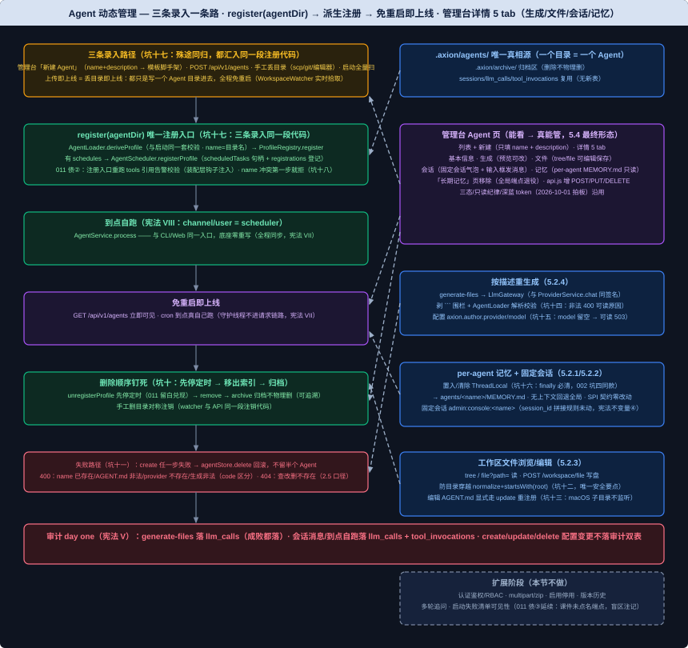

# Agent 动态管理模块设计文档

> 需求编号：012-agent-mgmt | 对应课件第 30 节《动态管理 Agent：一句话生成、上传即上线》（新版 PDF 13 页，PyMuPDF 提取全文复核）
> 文档依据：`docs/TechnicalSolution.md` §11.3/§11.4/§12.1（权威设计源）、`docs/DemandAnalysis.md` §5.2/§13、`docs/AiProgrammingGuide.md` §6（增量阶段）、宪法 II/VII/VIII（`.specify/memory/constitution.md`）、课件第 30 节（实施级事实源）
>
> 修订说明（2026-10-02）：
>
> ① **口径拍板——以课件「五、实现回写」为准**：课件第 30 节自带设计演进记录——「一~四」为原始设计（generate 端点、只读工作区），「五、实现回写（5.1~5.4）」为**最终实现**（取消 generate 端点改按模板脚手架、工作区可编辑、增补四块能力），课件明言「以下以实现为准；上文保留，作为设计演进的记录」。本设计文档**按最终实现成文**，原始设计不再立项。技术方案 §11.3 仍为原始设计口径，**成文后同步回写**（设计文档即未来课件，§11.3 是权威源不可留两套说法）。
> ② **前序交付物改造点清单（课件点名，全部为 5.1~5.4 明示）**：`AgentScheduler` 增 `unregisterProfile`（011 留白兑现）；`ToolExecutor.execute` 签名增 agentName（002 交付物扩展）；`MemoryService` 增 `readAll(agentName)`（006 门面扩展，LongTermMemoryStore SPI 与三档契约测试**零改动**）；`MarkdownMemoryStore` 路径解析改 per-agent（006 内部改造）；**移除全局 `GET /api/v1/memory`**（009 端点退役，管理台「长期记忆」页随之移除）；`AgentApiController` 在既有 invoke 之上扩五端点。
> ③ **命名口径**：课件原文 OryxOS 字样按 2026-10-01 更名拍板全量对应 Axion（`oryxos.author.*` → `axion.author.*`、`.oryxos/` → `.axion/`）。
> ④ **011 三笔债处置**：债①（registerProfile 两步非原子）→ 本节交付 `unregisterProfile`，store 增删仍归后续；债②（tools 引用告警仅启动路径）→ 本节运行时注册入口重跑同一校验（装配层钩子注入，见 FR-5）；债③（启动加载失败 Agent 清单可见性）→ 课件未点名端点，本节**不做**（明确不做·已知观测盲区延续）。

## 背景与价值

29 节立住了"一个目录 = 一个 Agent"与运行时注册的三个前置（`ProfileRegistry.register/remove/exists`、`AgentScheduler.registerProfile` + 句柄表、同一段注册代码）。但入口还停在"登录服务器往目录里放东西、还得重启才生效"——业务系统够不着、管理平台只能看不能管（课件 §开篇）。

本节把最后一块拼上：让 Agent 目录**实时生效**（丢进去即上线、免重启），把它包成 REST 端点，加"模板脚手架 + 按描述重生成"和一套**可编辑的工作区文件浏览**——运营在管理台说一句话或填个名字就造一个 Agent，或直接往目录丢一个 Agent，**两条路殊途同归**（课件 §一）。做完这一节，26 节管理平台"只读"的限制解除：管理平台从"能看"升级成"真能管"（课件 §一）。

对外要管的只有**一类资源——Agent（一个目录）**，不再有别的顶层概念（技术方案 §11.3）。一个 Agent 可以上传即上线、丢目录即上线、一句话重生成；能通过 API/页面增删改查、全程不重启；管理台还能像文件浏览器一样钻进一个 Agent 目录看它的 `AGENT.md`、脚本、子指令（课件 §一）。

复杂度全在**编排顺序和失败回滚**（课件 §四）——创建中途失败不能留半个 Agent、删除必须先停定时再动索引、两条录入路径必须共用同一段注册代码。这正是单测主场：InOrder 钉顺序、异常注入钉回滚。

## 用户场景

**场景一（本节验收场景）：管理台新建 Agent，免重启到点自己跑**——运营在管理台 Agent 页填 name+description 点「新建」→ `POST /api/v1/agents` 脚手架出完整目录并注册，返回 200 后不重启、`GET /api/v1/agents` 立刻可见、到 cron 点自己跑、webhook 收到（课件 §一/§九验收清单）。

**场景二：丢目录也即上线**——运维直接把一个 Agent 目录拷进 `.axion/agents/`（scp/git/编辑器），几秒内 `WorkspaceWatcher` 实时拾取、登记、可用——不走 API 也行；删目录一样对称注销（课件 §2.1/§九）。

**场景三：按描述重生成文件**——已有 Agent 想换一套任务指令：详情页「生成」tab 填一句描述 → `generate-files` 用 LLM 产出 `AGENT.md` 等文件草稿，每个文件可编辑预览 → 「保存并生效」写入即生效（schedules 变更先注销旧句柄）（课件 5.2.4/5.4）。

**场景四：删除可追溯**——`DELETE /api/v1/agents/{name}`：注销定时 → 移出索引 → 整个目录归档 `.axion/archive/`，不物理删；它干过的事仍在 `llm_calls`/`tool_invocations` 里查得到（课件 §2.4/§九）。

**场景五：每个 Agent 一个专属记忆、一条固定会话**——管理台详情页「记忆」tab 读这个 Agent 自己的 `.axion/agents/<name>/MEMORY.md`（save_memory 落在本 Agent，不再是全局一份）；「会话」tab 是它的固定会话（channel=admin、user=console），对话上下文可累积，不会串到别的 Agent（课件 5.2.1/5.2.2）。

## 功能需求

> 从课件 30 节「五、实现回写」5.1~5.4 提炼（原始设计仅作演进记录）。**交付物列是本节对外概念的白名单**，清单之外的新增对外概念必须停下报告。

| 编号 | 需求 | 交付物（落位模块） | 来源 |
|------|------|-------------------|------|
| FR-1 | **`WorkspaceWatcher` 实时监听（本节唯一新基础设施）**：装配层一个守护线程（与 `AgentScheduler` 调度线程同类，不进请求链路，宪法 VII 不违反——课件 2.1 明示），JDK `WatchService` 监听 `.axion/agents/` 变更；启动先全量扫一遍（复用 `AgentLoader.loadAll` 同款扫描），之后实时监听：目录新增/改 → 调 `AgentLifecycleService.register(agentDir)`（与 API 上传写完目录后调的**同一个方法**，坑十七），目录删除/移走 → 注销（同一段注销代码）；单个坏目录 WARN 跳过**不拖垮监听**（课件 2.1 尾部代码注释） | `WorkspaceWatcher`（axion-core；装配于 CliAgentConfiguration，守护线程 daemon） | 课件 2.1/§三；技术方案 §11.3 |
| FR-2 | **`AgentLifecycleService` 编排者**：`register(agentDir)`（deriveProfile → `ProfileRegistry.register` → 有 schedules 则 `AgentScheduler.registerProfile`——与启动扫描同一段代码，坑十七）；`create(req)` 四步编排（**坑十八** name 冲突第一步就拒一个目录都不写 → 写 Agent 目录 → `register(agentDir)` → 定时注册），**任一步失败删掉已写文件回滚**（**坑十一**，不留半个 Agent）；`update(name, req)`（改正文/覆写 provider 即时生效；**schedules 变则先注销旧句柄再注册新**）；`delete(name)`（**坑十** 顺序钉死：注销定时 → 移出索引 → 目录归档 `.axion/archive/` 不物理删）；`get(name)`；生成经 **`LlmGateway` 端口**（core 依赖倒置，001 交付——避免 core→provider 反向依赖；落 `llm_calls` 审计由 001 契约保证） | `AgentLifecycleService`（axion-core） | 课件 2.2/5.1/§三/§四；技术方案 §11.3 |
| FR-3 | **`AgentScheduler.unregisterProfile`（011 留白兑现）**：遍历 `profile.schedules()` 从 `scheduledTasks` 句柄表取每条 `ScheduledFuture` 调 `cancel(false)` 再移除句柄与 `registrations` 登记——只注销定时触发，**不动 `taskLocks`**（课件 §三明示）；这是 011 债① 的处置半边（store 增删仍归后续节） | `AgentScheduler.unregisterProfile`（axion-core） | 课件 2.2/§三；011 债① |
| FR-4 | **`agentStore` 目录读写**：`write(name, agendMd)`（写 `.axion/agents/<name>/AGENT.md`，与手工丢目录格式一模一样）、`writeAll(name, files)`（写一组文件，5.2.4）、`archive(name)`（整个 Agent 目录移入 `.axion/archive/`，不物理删）、`delete(dir)`（回滚用）；脚手架模板（`AGENT.md` + `scripts/` + `skills/` + `REFERENCE.md` 目录骨架，模板内容为实现级明确：provider 缺省取 `axion.author.provider`、tools 空、schedules 空） | `agentStore`（axion-core） | 课件 5.1/§三 |
| FR-5 | **Agent 端点全集（5.3 全表：AgentApiController 扩十端点 + WorkspaceApiController 三端点）**：`POST /api/v1/agents`（{name, description} → 脚手架 + 派生注册）、`GET /agents`、`GET /agents/{name}`、`PUT /agents/{name}`、`DELETE /agents/{name}`、`POST /agents/{name}/invoke`（26 节已有，不变）、`GET /agents/{name}/memory`（FR-8）、`GET /agents/{name}/session`、`POST /agents/{name}/session/messages`（FR-9）、`POST /agents/{name}/generate-files`、`POST /agents/{name}/files`（FR-6/FR-7）、`POST /api/v1/workspace/file`（FR-6）。**错误码沿用 26 节口径**：name 已存在/AGENT.md 非法/provider 不存在/生成产物非法 → 400（code 各自区分，新增 code 值实现级明确）；查/改/删不存在 → 404；统一 `ApiResponse` 信封（课件 2.5）。**011 债② 处置**：注册入口重跑 tools 引用告警校验——校验逻辑在装配层（005 `validateToolRefs` 同款），core 不得反向依赖 tool，以**装配层注入校验钩子**方式接入 register(agentDir)（钩子形态实现级明确） | `AgentApiController` 扩展 + `WorkspaceApiController` + DTO（axion-web）；`ErrorCode` 增条目（axion-web） | 课件 2.2/2.5/5.3/§三；技术方案 §11.3；011 债② |
| FR-6 | **工作区文件浏览与编辑（5.2.3）**：`GET /api/v1/workspace/tree`（agents/ 每个 Agent 一个目录可展开 + archive/ 目录树）、`GET /api/v1/workspace/file?path=`（读文本）、`POST /api/v1/workspace/file`（{path, content} 写盘）——**坑十二** 防目录穿越是唯一安全要点：path 解析为绝对路径后 `normalize()` 校验必须落在 `.axion/` 内（`startsWith(root)`），否则 400；**坑十三** WatchService 不监听子目录内文件改动（macOS 实录），编辑 `agents/<name>/AGENT.md` 必须显式走 `AgentLifecycleService.update`（写 + 校验 + 重注册），其余文件直接写盘 | `WorkspaceApiController`（axion-web） | 课件 5.2.3/§七；技术方案 §11.3 |
| FR-7 | **按描述重生成文件（5.2.4）**：`POST /agents/{name}/generate-files {description}`——一次 LLM 调用（走 `ProviderService.chat` 语义、经 LlmGateway 端口、**落 `llm_calls` 审计**（宪法 V））产出 `AGENT.md` → `AgentLoader` 解析校验（非法 → 400 可读原因，**坑十四**）→ **剥掉模型偶尔多吐的 ``` 代码围栏** → 返回 {相对路径 → 内容} 给前端预览可改，**不落盘、不注册**；输出的 provider 若该 Agent 已存在则沿用其 provider（保持可跑）；`POST /agents/{name}/files {files}` 保存（可能被用户改过的）一组文件——先校验 `AGENT.md` 可解析（非法 → 400，不写坏目录）→ `agentStore.writeAll` → 覆写后重注册（schedules 变更先注销旧句柄），写入即生效。**生成用 provider/model 取系统默认**：新配置键 **`axion.author.provider` / `axion.author.model`**（provider 缺省取 `axion.providers` 第一个；**坑十五** model 留空则生成端点返回可读 503，不得向 OpenAI 兼容端点发 model=null） | `AgentLifecycleService.generateFiles/saveFiles`（axion-core）+ 配置键（application.yaml）；生成用系统提示词 `AGENT_AUTHOR_PROMPT` 落 `prompts/prompts.md`（课件点名 docs/prompt/prompt.md，仓库现有 prompts/prompts.md——落位实现级明确） | 课件 5.1/5.2.4/5.3；宪法 V |
| FR-8 | **每个 Agent 专属记忆（5.2.1）**：全局 `.axion/memory/MEMORY.md` → per-agent `.axion/agents/<name>/MEMORY.md`（跟 AGENT.md/skills/ 同目录，合宪法 IV）。机制：新增 **`ToolExecutionContext`**（`ThreadLocal<String> agentName`，axion-core）——`ToolExecutor.execute` 增 agentName 参数（002 交付物签名扩展，课件点名「ToolExecutor 执行工具前置入」），执行工具前置入 `profile.name()`、**finally 清除**（**坑十六**，002 坑四同款泄漏纪律）；读路径（`buildContext`/`readAll`）不经 ToolExecutor，由 `MemoryServiceImpl` 在委托 `store.load` 前后临时置入 Agent 名（buildContext 取 `session.profileName()`、readAll 取入参）再复原。**LongTermMemoryStore SPI 与三档后端（Markdown/SQLite/Mem0）契约测试一行不改**、完全向后兼容——无 Agent 上下文时 Markdown 档回退全局路径；**只有默认 Markdown 档变 per-agent**（`MarkdownMemoryStore` 构造改 workspaceRoot、运行时按上下文解析路径，006 内部改造）。端点：`GET /api/v1/agents/{name}/memory`；**移除全局 `GET /api/v1/memory`**（009 端点退役，管理台「长期记忆」页随之移除） | `ToolExecutionContext`（axion-core 新增）、`ToolExecutor` 签名扩展（axion-core）、`MemoryServiceImpl`/`MarkdownMemoryStore` 改造（axion-memory）、`MemoryService` 增 `readAll(agentName)`（axion-core 门面扩展）、`MemoryApiController` 调整（axion-web） | 课件 5.2.1；宪法 IV/VII |
| FR-9 | **一个 Agent 一条固定会话（5.2.2）**：管理台每个 Agent 恰好一条会话——固定 `channel="admin"` + `user="console"` + `profile=<Agent 名>`，`SessionManager` getOrCreate 幂等 → 恒为同一条 `admin:console:<name>`（**session_id 拼接规则未动**，只固定 channel/user，宪法不变量④维持）；`GET /agents/{name}/session` 返回 SessionView（sessionId + profileName + 最近 ≤100 条消息）；`POST /agents/{name}/session/messages {content}` 往固定会话发消息、触发 ReAct（同 invoke 入口，但落在固定会话里累积上下文） | `AgentApiController` 两端点（axion-web）；SessionView DTO | 课件 5.2.2/5.3；宪法 VIII |
| FR-10 | **管理台 Agent 页（5.4 最终形态）**：不再有独立「工作区」菜单，对外一个 Agent 列表（含「新建 Agent」= 只填 name+description）；点「详情」进入 5 个 tab——**基本信息**（name/description/provider/model/tools/定时）、**生成**（填一句描述 → 生成 → 每文件可编辑预览 → 保存并生效）、**文件**（左侧文件树、右侧可编辑并保存）、**会话**（固定会话对话气泡 + 输入框发消息）、**记忆**（per-agent MEMORY.md，只读，由 save_memory 写入）。改造点：现有「长期记忆」页（全局端点退役）**移除**；ProfilesView/SessionsView/定时任务/状态页课件未点名移除 → **保留**（实现级明确）；双信封封装增 POST/PUT/DELETE 三法（api.js 扩展，009 拍板 B 单一解析点）；三态规范、只读纪律（仅本节点名的写操作）、深蓝 token（2026-10-01 拍板）沿用 axion-admin-ui skill | `AgentView.vue` + `AgentDetailView.vue` 新增、`MemoryView.vue` 移除、`api.js` 扩展（axion-web frontend） | 课件 5.4/§七/§九 |
| NFR-1 | 全程同步阻塞（宪法 VII）：`WorkspaceWatcher` 是后台守护线程（基础设施，与调度线程同类），**不进请求链路**——不引入 Reactor/异步编程模型（课件 2.1 明示） | — | 宪法 VII；课件 2.1 |
| NFR-2 | 三条录入一条路：API 上传、手工丢目录、启动扫描**都汇入同一段 `register(agentDir)`**——同一套校验、同一异常、同一消息，行为必须一模一样（harness 钉死，坑十七） | — | 课件 2.1/2.2/§九；技术方案 §11.3 |



### 核心代码骨架（与课件 §三/5.x 一致，签名级契约）

```java
// axion-core：AgentLifecycleService（编排者——三步注册/回滚/注销顺序是本节全部复杂度所在）
@Service
public class AgentLifecycleService {
  /** 注册单个 Agent 目录——API 上传写完目录后同步调它、WorkspaceWatcher 监听到变更也调它。同一段代码。 */
  Profile register(Path agentDir) {
    Profile profile = agentLoader.deriveProfile(agentDir);   // 解析 + 校验（与启动同一套）
    profileRegistry.register(profile);                       // 运行时注册（29 节）
    if (!profile.schedules().isEmpty()) {
      agentScheduler.registerProfile(profile);               // 注册定时（29 节）
    }
    return profile;
  }

  public AgentView create(CreateAgentRequest req) {
    if (profileRegistry.exists(req.name())) {
      throw new InvalidRequestException("Agent 已存在: " + req.name());   // 坑十八：第一步就拒，一个目录都不写
    }
    Path agentDir = agentStore.write(req.name(), req.toAgentMarkdown());  // ① 写 Agent 目录（AGENT.md）
    try {
      return AgentView.from(register(agentDir));   // ② 走跟监听器完全同一段注册代码
    } catch (RuntimeException e) {
      agentStore.delete(agentDir);                 // 坑十一：中途失败回滚已写的目录，不留半个 Agent
      throw e;
    }
  }

  public void delete(String name) {
    Profile profile = profileRegistry.findByName(name)
        .orElseThrow(() -> new AgentNotFoundException(name));   // → 404
    agentScheduler.unregisterProfile(profile);   // 坑十：先停定时（29 节留的句柄兑现）
    profileRegistry.remove(name);                // 再移出索引——顺序反了：定时还在跑、Profile 已没，触发即空指针
    agentStore.archive(name);                    // 最后归档 .axion/archive/，不物理删
  }
}

// axion-core：WorkspaceWatcher（装配层守护线程；事件与 API 共用同一段注册/注销代码）
void onAgentDirChanged(Path agentDir, Kind kind) {
  try {
    if (kind == ENTRY_DELETE)  lifecycle.unregisterByDir(agentDir);   // 手工删目录 → 注销（与 API 删除同一段）
    else                        lifecycle.register(agentDir);        // 手工新增/改 → 同一段注册代码
  } catch (RuntimeException e) {
    LOG.warn("Agent 目录 {} 变更处理失败，跳过：{}", agentDir.getFileName(), e.getMessage()); // 单个坏目录不拖垮监听
  }
}

// axion-core：ToolExecutionContext（5.2.1 per-agent 记忆的上下文载体，ThreadLocal 泄漏纪律同 002 坑四）
public final class ToolExecutionContext {
  private static final ThreadLocal<String> CURRENT = new ThreadLocal<>();
  public static void set(String agentName) { CURRENT.set(agentName); }
  public static String current() { return CURRENT.get(); }
  public static void clear() { CURRENT.remove(); }
}
```

### 本节交付物清单（Spec-Kit 拆解锚点 / axion-spec 交付清单比对基准）

**代码**：`AgentLifecycleService`、`WorkspaceWatcher`、`agentStore`、`AgentScheduler.unregisterProfile`、`ToolExecutionContext`、`ToolExecutor.execute` 签名扩展（改造点）、`MemoryService.readAll(agentName)`（改造点）、`MemoryServiceImpl`/`MarkdownMemoryStore` per-agent 路径（改造点）、`AgentApiController` 扩十端点（create/get/list/update/delete/memory/session/session-messages/generate-files/files）+ `WorkspaceApiController` 三端点（tree/file 读/file 写）+ `AgentView`/`FileNode`/DTO、`ErrorCode` 增条目、管理台 `AgentView.vue`/`AgentDetailView.vue` + `api.js` 扩展 + `MemoryView.vue` 移除、`axion.author.provider/model` 配置键、`AGENT_AUTHOR_PROMPT` 提示词（prompts/prompts.md）、`CliAgentConfiguration` 装配接线（watcher 守护线程 + 校验钩子 + author 配置）

**测试**：`AgentLifecycleServiceTest`（InOrder 钉顺序 + 异常注入钉回滚）、`WorkspaceWatcherTest`（丢目录即注册/删目录即注销/坏目录不拖垮）、`WorkspaceApiControllerTest`（tree/file 读 + **目录穿越 400 关键回归** + 写盘 + AGENT.md 编辑走 update 重注册）、`GenerateTest`（草稿可被 AgentLoader 解析、不落盘不注册、非法 400、围栏剥离）、`AgentApiControllerTest`（端点薄转发 + 冲突 400/不存在 404 + 统一信封）；改造点回归：`ToolExecutorTest`（agentName 置入/清除）、`MemoryToolsTest`/`MemoryServiceTest`/`MarkdownMemoryStoreTest`（per-agent 落点 + 无上下文回退全局）、006 契约测试**零改动回归**、009 `MemoryApiControllerTest` 调整（全局端点移除）

**表**：无新表（会话复用 `sessions`、审计复用 `llm_calls`/`tool_invocations`；归档是目录非表）

**约定**：一个目录、两条录入路径、一段注册代码（殊途同归）；删除 = 注销→移出索引→归档（不物理删，可追溯）；全局记忆退役、per-agent 记忆上线（仅默认 Markdown 档）；一个 Agent 一条固定会话（admin:console:<name>）；工作区文件写盘必须防目录穿越

### 配置形态示例

```yaml
# application.yaml（axion-boot）——生成用 provider/model 的系统默认（5.1 拍板：系统没有"默认 model"）
axion:
  author:
    provider: deepseek     # 缺省取 axion.providers 第一个；生成类端点（generate-files）用
    model: deepseek-chat   # 留空则生成端点返回可读 503，不向 OpenAI 兼容端点发 model=null（坑十五）
```

## 明确不做

> 来源：课件 §七「先别做」清单 + 技术方案 §11.3 边界 + 011 债③ 延续。

- **认证鉴权**（谁能建 Agent/读文件——内网假设，扩展阶段随 API Key/RBAC 补）、**multipart/zip 上传**（本版 JSON create 只写 AGENT.md + 脚手架，带脚本的复杂 Agent 走手工丢目录）、**Agent 启用/停用状态位**、**创建时 dry-run 试跑**、**Agent 版本历史**、**一句话生成的多轮追问式细化**：扩展阶段（课件 §七）
- **启动加载失败 Agent 的清单可见性**：011 债③ 延续——课件最终实现未点名任何失败清单端点，本节不发明端点（新增对外概念须停下报告）；维持 ERROR 日志跳过口径，观测盲区继续注记
- **Agent 同名冲突策略、Agent 市场/共享、跨 Agent use_skill**：扩展阶段（011 不翻案）
- **通知渠道 CRUD**：004 拍板归 Web 扩展，本节不翻案
- **全局 `GET /api/v1/memory` 的兼容保留**：不做——课件 5.2.1 明示移除（退役即删，不留双路径）

## 验收标准

### 自动化部分（harness 承载，`mvn clean verify` 全绿即通过）

测试分层：全单测不碰网络（真模型/真链路挪人工部分，008/010 先例）。**每个在"功能需求"中点过名的坑，都必须有一个对应回归测试钉死**：

| 测试类 | 关键回归点 |
|--------|-----------|
| `AgentLifecycleServiceTest` | create 按序执行（**坑十八回归**：name 冲突第一步就拒、一个目录都不写）；注册失败回滚已写目录（**坑十一回归**）；create 与 watcher 走同一段 register(agentDir)（**坑十七回归**）；delete 按「注销定时 → 移出索引 → 归档」顺序（**坑十回归**，InOrder）；update 改 schedules 时先 unregister 后 register |
| `WorkspaceWatcherTest` | 往 `.axion/agents/` 手工丢一个 Agent 目录 → 监听事件触发 register(agentDir)、Agent 出现在 ProfileRegistry（免重启）；删目录 → 注销（与 API 删除同一段代码）；单个坏目录不拖垮监听 |
| `WorkspaceApiControllerTest` | tree 返回 agents/archive 结构、可钻进 Agent 目录列文件；`file?path=../../etc/passwd` 目录穿越 → 400（**坑十二回归**，关键回归）；正常文件返回内容；写盘落对位置；编辑 AGENT.md 走 update 重注册（**坑十三回归**） |
| `GenerateTest` | generate-files 产出能被 AgentLoader 解析的 AGENT.md 草稿；只生成、不落盘、不注册；LLM 产出非法 → 400 可读原因（**坑十四回归**）；``` 围栏被剥离；model 未配 → 可读 503（**坑十五回归**） |
| `AgentApiControllerTest`（standalone MockMvc） | 端点薄转发；冲突 → 400、不存在 → 404、统一 ApiResponse 信封（2.5 口径） |
| 改造点回归 | `ToolExecutorTest`：agentName 置入/执行后 finally 清除（**坑十六回归**）；`MemoryToolsTest`/`MemoryServiceTest`/`MarkdownMemoryStoreTest`：per-agent 落点 + 无上下文回退全局；006 `LongTermMemoryStoreTest` 契约**零改动**回归；009 `MemoryApiControllerTest` 随全局端点移除调整 |

最值钱的回归测试（课件 §八原文，关键断言直接可抄）：

```java
@Test
void 注册失败_必须回滚已写的Agent目录_不留半个Agent() {
    doThrow(new ProfileValidationException("bad")).when(profileRegistry).register(any());
    assertThrows(ProfileValidationException.class, () -> lifecycle.create(validRequest("half")));
    verify(agentStore).delete(any());               // 已写的目录被删回去
    verify(agentScheduler, never()).registerProfile(any()); // 定时根本没走到
    assertFalse(profileRegistry.exists("half"));    // 系统里干干净净
}

@Test
void 删除必须先停定时_再动索引和目录() {
    lifecycle.delete("weather-daily");
    InOrder o = inOrder(agentScheduler, profileRegistry, agentStore);
    o.verify(agentScheduler).unregisterProfile(any());  // 顺序反了：定时还在跑、Profile 已没
    o.verify(profileRegistry).remove("weather-daily");  // ——触发即空指针（时序窗口，人工撞不上）
    o.verify(agentStore).archive("weather-daily");
}
```

跑法：`mvn clean verify`（全模块，10 模块全绿 + 静态门禁全过——010 实录：IDE 污染 target/ 时报 Unresolved compilation problem，先 `mvn clean`）。

### 人工部分（做完怎么验）

- **建 Agent 即上线**：`axion serve` 后 POST /api/v1/agents 成功不重启，GET /api/v1/agents 立刻可见；cron 临时设每分钟，到点真自己跑、webhook 收到（真链路，真 key）
- **丢目录也即上线**：往 `.axion/agents/` 直接拷一个 Agent 目录（不走 API），几秒内 GET /api/v1/agents 就出现——WorkspaceWatcher 实时拾取，与 API 上传殊途同归
- **一句话重生成**：详情页「生成」填描述 → 草稿可解析、不落盘；页面预览可改后「保存并生效」
- **目录落对地方**：建 Agent 后 `.axion/agents/<name>/` 有 AGENT.md（+ 脚手架 scripts//skills//REFERENCE.md），格式跟 29 节手写的一致
- **文件浏览器**：管理台「文件」tab 列出 agents/ 每个 Agent、钻进目录看 AGENT.md/脚本内容；`file?path=` 传一个越界路径被 400 挡住
- **删除可追溯**：DELETE 后目录在 `.axion/archive/`，历史 llm_calls/tool_invocations 仍查得到
- **行为一致**：API 上传、手工丢目录、启动扫描——三种录入都走同一段 register(agentDir)（harness 钉死 + 人工各验一遍）
- **管理平台全流程**：界面走一遍「新建 Agent → 详情 5 tab 各看一眼 → 生成 → 保存 → 会话里发消息看它跑 → 记忆 tab 看 per-agent 落点 → 编辑 → 删除」
- **不回退**：`mvn clean verify` 全绿

## 依赖与假设

### 前序交付物（已就位，本节直接依赖）

- `AgentLoader.deriveProfile/loadAll`（011，name=目录名校验、schedules id 校验）、`ProfileRegistry.register/remove/exists`（011）、`AgentScheduler.registerProfile` + `scheduledTasks` 句柄表 + `registrations`（008/010/011）、`LlmGateway` 端口（001，签名与 `ProviderService.chat` 逐字一致——generate 的调用通道）、`ProviderService.chat`（001，落 `llm_calls` 审计）、`SessionManager` sessionIdOf + getOrCreate（002）、`ToolExecutor`/`ToolRegistry`（002/005）、`MemoryService` 门面 + `LongTermMemoryStore` 三档 + `MemoryTools`（006）、`ApiResponse` 信封 + `ErrorCode` + `GlobalExceptionHandler`（009）、`AgentApiController`（invoke 端点，009/26 节）、管理台六页 + 双信封 api.js + 深蓝 token（009/010 + 2026-10-01 拍板）、`notify_channels` 表（004）
- **现状确认（2026-10-02 实测）**：`ProfileRegistry` register/remove/exists 就位；`AgentScheduler` 有 registerProfile/scheduledTasks/registrations、**无 unregisterProfile**（011 留白，本节交付）；`LlmGateway` 端口与 ProviderService.chat 签名一致（`chat(sessionId, profile, prompt)`）；`MemoryService` 接口为 buildContext/remember/recall 三法、**无 readAll**；`MarkdownMemoryStore` 构造为单路径 `(Path memoryFile)`；`ToolExecutor.execute(String sessionId, ToolCall)` 无 agentName；`validateToolRefs` 在 CliAgentConfiguration:364（仅启动路径）；管理台现有六页（MemoryView 本节移除）

### 前序缺口（H0 依赖检查）

**无**——课件假定依赖的部件全部实测就位（上述现状确认）；`unregisterProfile`/`readAll`/`ToolExecutionContext` 即本节交付物，不属缺口。

### 外部依赖与假设

- **WatchService 平台差异**：Windows/Linux 目录级事件可靠；macOS 不监听子目录内文件改动——已由坑十三机制兜底（编辑 AGENT.md 显式走 update 重注册）；监听与注册竞争窗口（目录正在写一半时事件到达）由"注册失败 WARN 跳过 + 下次事件重试"消化（实现级明确）
- **跨节契约**：本节交付的 `AgentLifecycleService.register(agentDir)`/`AgentScheduler.unregisterProfile`/`ToolExecutionContext`/per-agent 记忆路径，是第 31 节（三个真实 Agent 演示：天气/科技日报/GitHub 日报）与 32 节（打包发布）的**调用契约**——31 节的三个 Agent 将全部经本节的管理台/API/丢目录三路径之一上线，后续节改动视为修改前序公共接口，需停下报告
- **技术方案 §11.3 回写**：原始设计口径（generate 端点/只读工作区）已被课件最终实现取代，成文后同步回写技术方案 §11.3（设计文档即未来课件，权威源不留两套说法）
- **审计口径延续**：create/update/delete 是配置变更非 LLM/工具调用，不落审计双表；generate-files 是 LLM 调用必须落 `llm_calls`（宪法 V）；会话消息经 ReAct 照常落双表
- **跑通标准**：本节撑起第 31 节 Demo 的"Agent 上线机制"——三个演示 Agent 均可从管理台一句话建出、到点自跑；管理平台从只读升级为真能管
